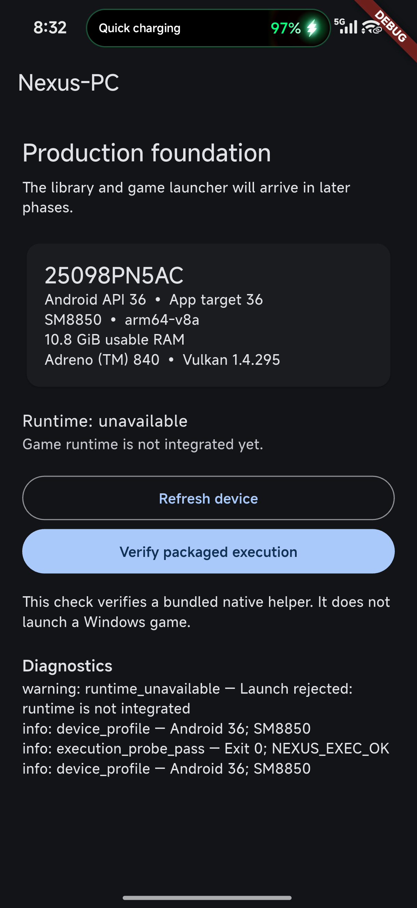

# Phase 1: production foundation

Implemented 2026-10-14. Scope: the modern-target application scaffold, typed bridge,
native device query, repeatable device checks and CI. Phase 2 product navigation,
library/import, cloud matching and the Windows runtime are not included.

## Acceptance

- Separate package `com.nexuspc.app`, ARM64, minimum API 31 and target API 36.
- Flutter diagnostic screen consumes typed native data; no fake launch success.
- Pigeon schema/generated Dart and Kotlin APIs cover device profile, prepare,
  launch, stop, status and bounded log/status events.
- Kotlin serial worker avoids blocking the main thread; teardown cancels work
  and drops callbacks after engine detachment. Flutter cancels subscriptions.
- CMake builds the JNI Vulkan query and fixed-path packaged execution helper.
- Flutter tests cover generated codec values/nullability, runtime error propagation,
  events, UI retry and disposal during a pending native operation.
- Production CI verifies generator drift, formatting, analysis, tests, ARM64 APK
  build, unsigned release compilation and Android lint, then uploads the debug APK. Physical-device checks run
  separately; a hosted runner is not a Xiaomi compatibility test.

## Physical-device evidence

On Xiaomi 17 Pro / HyperOS 3, ADB model `25098PN5AC`, Android 16 / API 36:

| Observation | Result |
|---|---|
| SoC / ABI | `SM8850` / `arm64-v8a` |
| Usable RAM | 11,556,110,336 bytes |
| Stock renderer / Vulkan | `Adreno (TM) 840` / `1.4.295` |
| Installed app target | 36 |
| Fixed-path packaged helper | `NEXUS_EXEC_OK`, exit 0 |
| Traversal request rejection | `invalid_argument` |
| Prepare without engine | `runtime_unavailable` |
| Game launch without engine | `runtime_unavailable` |
| Stop without engine | status remains unavailable |
| Invalid log limit | `invalid_argument` |
| Native log snapshot | nonempty, at most 128 entries |

The diagnostic hook requires a debuggable build and is disabled in release builds.
The device script supplies a per-run nonce and requires a fresh aggregate-pass
JSON report, preventing stale evidence from satisfying the gate.
See [recorded device checks](evidence/phase-1-xiaomi17pro.json).

Two consecutive cold-start native runs passed. Earlier visual inspection confirms
the typed profile values and unavailable-runtime state:

## Repeat validation

Follow [`app/production/README.md`](../app/production/README.md) for toolchain and
commands. ADB installation uses `--no-streaming` because HyperOS previously rejected
streamed installation. The production and Phase 0 packages can coexist.

## Review and remaining gates

Review covers protocol correctness, lifecycle ownership, bounded reads/logs,
fixed-path process creation (no shell/user command), path argument rejection,
dependency lockfile and separation from the experimental runtime. Generated code
is reviewed for matching wire types; hand-written behavior is independently tested.

Local Android lint has no errors. Toolchain-update and latest-target advisories
remain visible (the API-36 Xiaomi target is intentional), as does the ARM64-only
ChromeOS advisory. The unsigned release compiles; it is not a signed distribution
artifact. Native core/helper ELF load segments are aligned to 16 KiB; this is not
evidence of running on a separate 16-KiB-page device.

This foundation does not yet validate a modern-target Windows engine. Before
runtime integration, prove its loader/process placement, JIT and display/input
lifecycle on the actual phone. Do not downgrade production targeting merely to
reuse Phase 0. Distribution signing, license inventory for new runtime components
and cross-device performance remain later gates.

Next phase: the Flutter application shell. Commit/PR/merge Phase 1 into `develop`
before beginning that phase, following the [phase sequence](phase-0-feasibility.md#phase-sequence).
